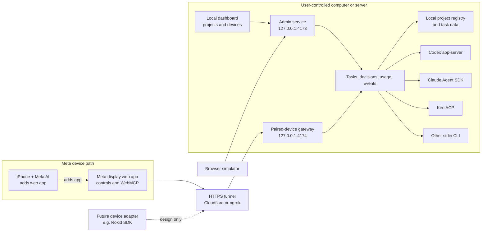

# Architecture

OpenGlassUI separates agent execution from device-specific presentation. The companion runs on a computer or server controlled by the user; it does not embed any particular user's projects, credentials, or session history in the repository.

Ports are defaults. The admin listener is for local setup; expose **only** the separate gateway listener through a tunnel. Both listeners bind to loopback. Requests to the gateway require a paired bearer token except for static assets and the one-time pairing exchange. Local management endpoints are unavailable on the gateway. Never expose the admin listener publicly.

## Pairing and trust

1. The user starts a tunnel to the gateway, then asks the local dashboard for a QR code.
2. The code contains an installation deep link and a random, single-use pairing secret valid for five minutes. Anyone who redeems it first can pair, so treat the QR as a password.
3. After redemption, the browser stores a bearer token; the companion stores its SHA-256 hash and non-secret device metadata. Tokens persist across companion restarts and can be revoked individually or all at once from the local dashboard.
4. A paired device may read tasks and sessions, send prompts and answer approvals for configured projects. It is not restricted to a single project or given a separate role. Remote traffic and prompts pass through the selected tunnel provider. Browser-side token storage and local task files are not encrypted by this project.

The service is a single-user prototype. The admin listener trusts local requests with the expected host and origin. Its separation from the gateway reduces exposure but is not a formal security audit, a multi-user authorization system, or protection against a malicious local process. A manually configured proxy must target the gateway port, not the admin port. Tunnel-provider authentication, TLS behavior, credentials, and access policies remain the operator's responsibility.

## Agents and sessions

Codex uses the app-server protocol; Claude uses the Agent SDK; Kiro uses ACP V3. Permission choices are returned to the originating agent, and Kiro's persistent permission choices are intentionally not exposed. The generic CLI adapter sends a prompt to stdin without a shell. Agent tools and credentials remain those configured by the user on the host. Only locally registered project IDs can be selected remotely; paths are not accepted from the glasses.

Kiro session listing and loading use the agent's ACP capabilities, with replay separated from a new prompt. Taking over an active session owned by a different process is not guaranteed; avoid concurrently resuming a session in multiple clients. Usage is displayed only when the agent supplies it; unavailable token or cost values are not estimated.

## Events, notifications, and devices

The gateway offers authenticated WebSocket revision events, with 25-second long polling as a fallback. The socket carries only revision numbers; task data is fetched through authenticated HTTP. This avoids continuous three-second polling while the socket is connected. When a task changes, an open glasses page shows an in-app notice for completion, failure, or a pending decision. The local dashboard can request browser notification permission. These mechanisms do not establish that Meta supports native background push notifications; they require an open client and must be tested on hardware. Long polling is not server-sent events.

The 600 × 600 simulator embeds the same glasses page and uses keyboard input. It is a development aid, not an optical, latency, hardware, or gesture emulator. Actions in the simulator affect real configured agents.

Meta-specific installation links and WebMCP registration live in the frontend. A future Rokid adapter could consume the same authenticated task API and map device-specific input and display to it. Rokid's [developer platform](https://open.rokid.com/) describes distinct CXR-L and CXR-S SDKs; neither SDK nor Rokid compatibility is implemented or verified here.
